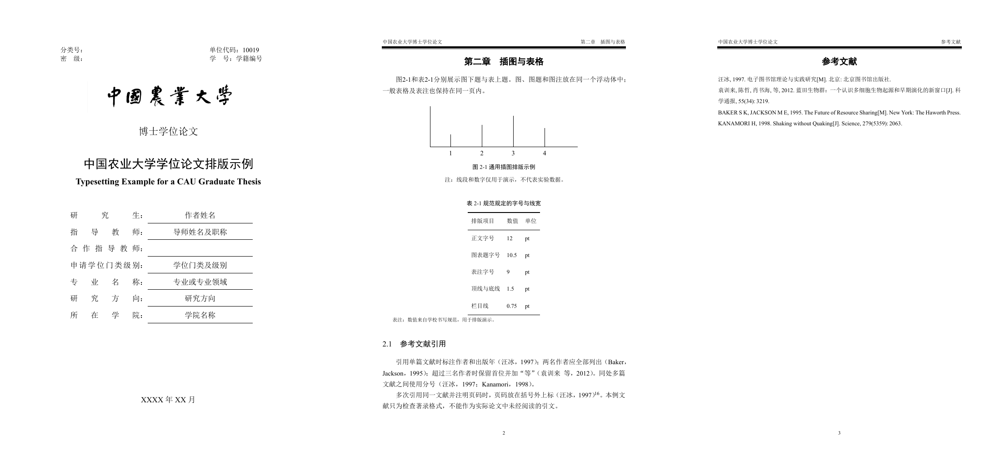

# 中国农业大学博士学位论文 LaTeX 模板

**CAU Thesis Template · 2025年修订规范 · 适用于2026年 · MIT开源**

[](https://www.overleaf.com/docs?snip_uri=https%3A%2F%2Fgithub.com%2FCBZ199671%2Fcau-thesis-template%2Freleases%2Fdownload%2Fv0.2.10%2Fcau-thesis-template-0.2.10-overleaf.zip&engine=xelatex&main_document=thesis.tex)

面向中国农业大学博士生的中文学位论文 LaTeX 模板。依据《中国农业大学研究生学位论文格式及书写规范（2025年修订）》（研生〔2025〕1号），并参考研究生院提供的官方“2025冬”Word模板制作。该规范自2026年1月1日起施行，本模板适用于按该规范撰写的2026年学位论文。

默认配置为学术博士，同时兼容硕士及专业学位。学校原始文件见[研究生院发布页](https://gradsch1.cau.edu.cn/art/2025/8/13/art_53277_1097893.html)。这是**非官方开源模板**，不代表学校发布或认证；提交前仍须核对所在学院的具体要求。

**v0.2.10（2026-10-26）**：新增两种参考文献格式，可用`bibstyle=authoryear`（默认校级细则）或`bibstyle=numeric`（信电学院通知）自由切换，具体选择按本院要求。切换示例见下方“文献引用”。本次验证两种模式的定点样张；未重跑全文排版或云端全量测试。

## PDF预览与下载

**[在线预览排版示例 PDF（13页）](preview/thesis-example.pdf)** · [在线预览空白模板 PDF（15页）](preview/thesis-blank.pdf) · **[下载 v0.2.10 正式字体精简模板 ZIP](https://github.com/CBZ199671/cau-thesis-template/releases/download/v0.2.10/cau-thesis-template-0.2.10-clean.zip)**

下方PDF及预览图保留v0.2.9的著者—出版年制排版示例；新版下载包支持两种模式。点击预览图，可在GitHub中打开完整示例PDF。图片取自实际编译输出，依次展示封面、图表正文、参考文献；示例内容不构成真实研究成果。

[](preview/thesis-example.pdf)

精简ZIP只含21个写作必需文件，不含脚本、测试、缓存或生成PDF；仓库另附`preview/`，仅用于项目首页展示。开始写作建议下载上方精简ZIP，而不是GitHub自动生成的整个仓库压缩包。

## Overleaf 在线使用

**[一键在 Overleaf 打开](https://www.overleaf.com/docs?snip_uri=https%3A%2F%2Fgithub.com%2FCBZ199671%2Fcau-thesis-template%2Freleases%2Fdownload%2Fv0.2.10%2Fcau-thesis-template-0.2.10-overleaf.zip&engine=xelatex&main_document=thesis.tex)** · [下载在线预览 ZIP](https://github.com/CBZ199671/cau-thesis-template/releases/download/v0.2.10/cau-thesis-template-0.2.10-overleaf.zip)

1. 登录Overleaf，点击上方按钮，创建属于你自己的模板副本。
2. 入口已指定 **XeLaTeX** 和根目录下的 **`thesis.tex`**；首次导入后等待编译完成。若手动上传ZIP，请自行选择这两个设置。
3. 修改 `thesis-info.tex` 和分章文件即可开始写作；目录、编号及文献由latexmk/Biber处理。此入口是[Overleaf官方ZIP导入功能](https://www.overleaf.com/devs)，不要求连接GitHub账号或开启GitHub同步；副本不会随原仓库自动更新，也不表示模板广场收录。

**在线预览不等于正式提交稿。** 在线包同样只有21个文件，不含个人论文、商业字体、脚本、测试、缓存或预生成PDF；第一章和文献库只附一条公开校方规范的真实引用用于演示，写作时替换。两个入口 `thesis.tex`、`spine.tex` 使用已有的 `fontset=fandol` 开源字体模式，每页保留“PREVIEW ONLY”警示；`latexmkrc` 不固定本地 `build/` 路径，输出由平台管理。将在线包下载到本地编译时，输出为 `thesis.pdf` 或 `spine.pdf`。

在线包与同版本正式包使用相同的 `cauthesis.cls`，不改变字号、边距、行距或标题规则。但是替代字体会影响字形、换行与分页，不能冒充学校要求的宋体、黑体及Times New Roman。正式包和仓库入口仍默认 `fontset=required`，缺字体时明确报错，不会自动降级；首页PDF维持正式字体排版，原v0.2.8下载附件保留。

在线协作后，下载源文件到依法取得所需字体的本机，将入口改回 `fontset=required`，重新编译并核对分页；不要通过删除预览警示把替代字体输出当作正式稿，也不要把商业字体上传至公共仓库。

**在线实测（2026-10-12）**：已验证官方ZIP一键导入；项目使用 `thesis.tex`、XeLaTeX和TeX Live 2026。v0.2.9在同一在线项目重新编译，生成15页PDF，面板显示 **All logs 0 / Errors 0 / Warnings 0 / Info 0**；真实示例引用和文后条目已生成，每页预览标记保留。七项旧日志分别通过正确的宏更新接口、分布胶/页眉填充修复、非空的公开规范引用、预览提示转普通说明处理，没有全局屏蔽告警或调高badness阈值。本次为通用预览及一条真实引用的云端验证，不代表正式字体、独立书脊、所有引用组合或任意长论文已完成云端全量测试；后续首次创建项目时建议选择本次验证的TeX Live 2026。

## 模板说明

当前版本为0.2.10。这是非官方模板，不代表学校认证。PDF明确条款优先；Word仅补充合理且不冲突的细节，不复制破坏对齐、层级或内容区边界的明显格式残留。两种排版引擎不保证任意内容逐像素相同，正式提交仍须符合学院要求。

0.2.9修复封面标签分布和页眉定位盒的Underfull信息，并为上游国标样式的两处宏替换使用正确的更新接口；正式示例封面、正文及文献三页的字符坐标与0.2.8对照，差值为0。主动选择Fandol时写普通说明日志，页面预览警示保留；缺少正式字体仍报错。在线示例补入公开校方规范的引用，避免空文献提示，不插入虚构的研究文献。

0.2.8依据规范第7页示例，将中文引文姓名与“等”之间的间距调整为半个字宽（正文12磅时为6磅），英文“et al.”及文后书目分隔符不变。重新核实原始Word后，恢复关键词、简介栏目和表注的合理首行缩进；作者简介首栏与章标题的基线间距标定为约31.92磅，后续栏目间距不变。验证范围为受影响的正式字体样张及本版预览编译，未重新执行全量回归。

0.2.7取消参考文献续行的21磅悬挂缩进，各行统一齐左；保留校级著者—出版年制，不新增数字序号。本版同时补齐关键词与摘要末行、清单子标题与首项的分页关联，同年专利消歧、PDF标题换行参数清理，以及独立的作者成果列表接口。已标定的摘要和其他标题间距保留。

0.2.6单独标定中英文摘要：标题到正文首行的基线距离均约19.56磅，与本机原生Word同文输出一致，修正旧版中文17.52磅、英文14.55磅的偏紧间距。标题18磅行框、正文20磅行框独立实现，字号与真居中不变；这个基线距离不是另插一行空白或学校明文规定的段后值。目录、清单、符号表及正文标题不随之加大间距。

本版保留0.2.4的标题真居中修复；标签缩进以0.2.8复核结论为准。继续保留此前修复的长目录／图表清单分页、参考文献首行位置、引用命令组合、页眉越界防护、书脊题目换行和后置附录编号。

末轮视觉核查另补齐页首浮动图表的避让：仅在页首浮动体及纯浮动页预留6磅，并从可用排版高度中扣除，保持整页列高与页码位置，避免图形碰页眉线或被推入页脚。普通正文、标题间距、页眉线位置不改。图形连同题注过高时会明确报错；应调整图片尺寸或拆分表格，不强行输出裁切页面。

## 排版依据与边界

“Word里存在某属性”不等于“学校要求这个属性”。字号、字重和标题内部必要字间距保留；正文缩进误带入居中标题、靠空段挤页码等编辑残留不复制。不得仅因个人审美更改PDF明文要求。

声明、摘要、Abstract、目录、图表清单和符号表标题按版芯居中；一级标题居中，二三级标题左对齐且不继承正文首行缩进。关键词、简介栏目及表注是左对齐段落，不应与居中标题的错误缩进一概而论：中文关键词首行缩进21磅，英文关键词及简介栏目首行缩进28磅，表注首行缩进18磅，续行均回到所在文本区域左侧。正文与简介内容仍保留24磅首行缩进，著者—出版年制参考文献各行齐左。这四处数值来自官方Word的合理排版细节，不冒称PDF明文要求。窄表的表注若需限制在表格宽度内，请把表格和表注放在同宽的`minipage`中，首行仍在该区域内缩进18磅。

居中基准是版芯而非整张纸：左30mm、右25mm，版芯中线距纸张左边107.5mm；不要人为左移2.5mm抵消它。正文、目录层级和签名区缩进不全局清零；著者—出版年制参考文献列表单独采用各行齐左。

## 开始写作

1. 安装含XeLaTeX、Biber和latexmk的TeX发行版；当前验证环境为TeX Live 2025。
2. 在 `thesis.tex` 选择学位类型，在 `thesis-info.tex` 填写个人信息。
3. 修改 `frontmatter/`、`chapters/` 和 `backmatter/`；在 `bibliography.bib` 加入真实文献。
4. 在模板根目录执行：

```text
latexmk -xelatex thesis.tex
```

输出是 `build/thesis.pdf`。目录、页码、图表编号和引用会自动更新。编辑器中选择XeLaTeX，不使用pdfLaTeX。无需安装Word、Python或PowerShell脚本。

摘要首行现用 `\cauabstractheading{摘\quad 要}` 和 `\cauabstractheading{Abstract}`；正文直接跟在后面，无需插空段或手动加垂直空白。从0.2.5升级且已经写了摘要时，保留自己的正文，只将两个摘要文件首行的 `\caufrontchapter` 改为 `\cauabstractheading`。仅替换类文件而保留旧调用不会启用专用摘要行框；其他前置标题继续用原命令。

需要书脊时执行 `latexmk -xelatex spine.tex`，输出 `build/spine.pdf`。其12mm宽度只是示例，应按装订厚度调整，不合并进正文PDF。

封面 `title` 中的 `\\`、`\\[间距]`、`\\*`、`\\*[间距]` 和 `\newline` 在生成书脊时去除，在PDF标题元数据中转为空格；星号和间距参数不会留下，真实文字与符号保留。英文控制词后接中文须用空格分开，例如 `\newline 评价`。特殊题目可在同一元数据文件中显式设置 `spine-title={书脊专用题目}`，不改变封面或PDF标题；如需把拉丁缩写或符号作为一个横排单元，用花括号分组，例如 `spine-title={作物{EIT}成像}`。书脊文字仍须与真实题目一致，不能用此接口擅自改题。

## 包内文件

Release中的精简使用包只含21个文件，不含测试、打包工具、开发记录、独立示例工程或预生成PDF。GitHub仓库额外提供`preview/`中的预览资料，不影响模板编译。

| 文件或目录 | 用途 |
|---|---|
| `thesis.tex` | 论文入口、学位选项和各部分顺序 |
| `thesis-info.tex` | 题目、姓名、导师等封面信息 |
| `cauthesis.cls` | 统一排版、声明、目录、图表及引用功能 |
| `frontmatter/` | 中英文摘要、符号表，共3个文件 |
| `chapters/` | 4个起始章节，可按研究内容增删 |
| `backmatter/` | 致谢、附录、作者简介，共3个文件 |
| `bibliography.bib` | 文献数据库 |
| `spine.tex` | 独立书脊 |
| `assets/cau-wordmark.png` | 封面校名字标 |
| `latexmkrc` | 编译配置，勿误删 |
| `.gitignore` | 防止将缓存、生成PDF和字体提交到GitHub |
| `README.md`、`LICENSE`、`NOTICE.md` | 使用说明与许可 |

分文件是为了分章编辑，不是额外软件依赖。四章结构和所有占位文字均可修改，并非学校规定的固定研究框架。添加章节时，在 `thesis.tex` 中加入对应的 `\input{chapters/文件名}`。

## 学位与字体

```latex
\documentclass[degree=doctor,type=academic,fontset=required]{cauthesis}
```

`degree` 可选 `doctor`、`master`；`type` 可选 `academic`、`professional`。前者切换“博士／硕士”，后者切换“专业名称／专业领域名称”。封面 `degree-name` 仍须填写实际授予学位全称。合作导师须符合备案条件，最多两人，用 `\\` 分行；长题目可换行，不应缩小规定字号。

正式模式需要系统可识别的宋体（SimSun）、黑体（SimHei）和Times New Roman。缺字体会报错，不会静默替换；请自行合法取得并安装。macOS、Linux及在线编辑器不保证预装这些字体，不要把商业字体放进公共仓库。数学使用TeX Gyre Termes Math，这是实现选择而非学校指定的数学字体。

只需协作预览时可选 `fontset=fandol`，使用开源替代字体。普通页面显示“PREVIEW ONLY”，窄书脊显示两行短警示“预览／勿提交”，避免长横幅被纸边裁切。正式提交前切回 `required` 并复核分页。当前没有声称在所有操作系统及在线平台上完成验证。

校名字标来源及权利见[NOTICE](NOTICE.md)。如需自行取得，应从学校官方Word中保存或导出字标，不拉伸、不重新绘制；可通过 `\thesissetup{wordmark={自己的图片路径}}` 指定对应图片。

## 正文分页与图片上下留白

**每章只有最后一页允许自然形成较大的页尾空白；其余正文页不得出现异常大片空白，尤其是图片上方和下方。** 这是本模板根据作者排版经验增加的写作与验收约束，不作为学校规范原文引用。正常页边距、标题间距、图文间距及少量行尾余量仍应保留。

- **优先图文合排。** 中等尺寸图片不要单独占一页并上下留出大片空白。普通图片优先使用 `[!htb]`，并放在相关引述附近；仅确需接近满版的大图才考虑 `p`。`!` 放宽浮动比例限制，但不保证任意内容自动排满。
- **先排查图片上下及相邻页。** 检查不必要的 `\newpage`、`\clearpage`、强制浮动屏障、`[H]`、大段不可分页容器，以及图片文件自身的空白画布。按需调整浮动位置、引述与图的位置、图的合理显示尺寸；保留图内文字、图题和已认可的图件内容。
- **不能用另一处空白替代原问题。** 仅把独立图页改为顶部对齐，会把空白移到图下，不能算修复；章中的独立图片页也不享有章末页例外。避免为每张图清页或强制原位放置。
- **保持规定版式和内容。** 不通过改变正文字号、行距、页边距，拉大段间距或图文间距，增删正文来填满页面。模板保留页首图表避让和页脚安全边界。
- **以最新 PDF 验收。** 对本次受影响的图片页及相邻页查看图片上方、图题下方和页尾；只有章节最后一页可自然留出较大页尾空白。先确认 PDF 路径及生成时间，必要时使用带时间的新文件名打开，避免旧预览造成误判。编译成功不等于分页合格；只复核受影响范围，不据此扩大为无关的全量检查。

上述规则是排版验收约束，不是对任意正文自动消除留白的保证。发现问题应结合具体图文调整后重新查看相关页面。

### 图、表、公式及页顶页底的允许范围

按学校官方Word的实际段落格式，图题为五号黑体、图注为五号宋体，均采用固定20磅行距、段前段后0。原生Word同文样张测得，图题与图注相邻基线约20磅，图注末行与正文首行也约20磅。本模板已去掉额外的图注段前胶，并校准图片、题注及浮动体边界的叠加间距。

| 检查项目 | 测量方式 | 本模板验收范围 |
| --- | --- | --- |
| 图片至图题 | 图片可见下缘至图题文字可见上缘 | 通常5～12磅；无外白边标定图下缘至图题基线约16磅 |
| 图题至图注 | 相邻文字基线 | 20磅，续行仍20磅 |
| 图注至正文；无图注时图题至正文 | 相邻文字基线 | 18～22磅 |
| 正文至表题 | 相邻文字基线 | 18～22磅 |
| 表题至表格上底线 | 表题末行基线至上底线的上缘 | 3～5磅，按Word样张标定 |
| 表格下底线至表注 | 下底线下缘至表注首行基线 | 15～17磅，目标16磅 |
| 表注续行 | 相邻文字基线 | 固定20磅 |
| 表注至正文 | 相邻文字基线 | 18～22磅，目标20磅 |
| 无表注时表格至正文 | 下底线下缘至正文首行基线 | 15～17磅，目标16磅 |
| 页顶 | 页眉最下方横线的下缘至正文、标题或图片的可见上缘 | 2～20磅，约0.7～7.1毫米 |
| 页底 | 正文、图题、图注或表注的最后一行主文字基线至页码基线 | 16～43磅，约5.6～15.2毫米；仅章末页允许超过上限 |

页顶、页底范围是作者提出的排版验收约束，不是学校明文数值。Word同文满页的末行至页码约22.44磅；允许约一行的分页变化，不要求每页距离相同。数学上下标不单独作为末行主文字。章首页仍保留官方章标题格式；无页眉的摘要等前置页按各自官方格式起排，不机械套用正文页顶测量。

图片PDF的MediaBox/CropBox或PNG画布可能带外白边，`caption`的间距小不代表肉眼看到的空白小。只对确认无内容的外白边使用`\includegraphics[trim=左 下 右 上,clip]{...}`，保留少量安全余量；不得裁掉标尺、标签或图形边框，不改原图，不用负`\vspace`覆盖空白。图片内部的分图布局不作外白边裁切。

**内部固定，外围窄幅调整。** 图题、图注、表题和表注的行距固定，不随页面剩余高度拉伸。表内行距及段落距离仍按官方Word标定。上表中18～22磅、15～17磅等范围是不同字号、字深与浮动位置的验收容差，不意味着每页任意选取一个值。标定样张中，有图注/表注到正文约20.83磅，无图注图题到正文约19.75磅，无表注底线到正文约16.08磅；每类边界各自稳定。

**正文观感优先，禁止用字距凑页。** 正文采用一致的自然断行和两端对齐；不得为填页逐段设置`\looseness`、放大`\tolerance`、增大中英文字符间距或强制增加段落行数。固定20磅行距与原段距同样不能改变。相邻段落字距明显不同，即使页底数值达标也判为不合格。顶底阈值用于发现分页问题，不能成为破坏字距、行距或段距的理由；调整图表位置、清除画布外白边、等比例尺寸和合理分页后仍超限的页面，必须如实列出，不能强行凑满。

没有图注时，只写图片和图题，直接接正文；没有表注时，只写表题和表格。省略对应命令，不写空的`\figurenote{}`或`\tablenote{}`，也不保留占位空段。后一种空命令会生成标签，不能代替“无注”布局。

公式使用窄幅弹性间隔：普通上下胶为`10bp plus 2bp minus 2bp`（8～12磅）；TeX判定前文为短行时，上下短胶为`6bp plus 1bp minus 1bp`（5～7磅）。这些是公式盒外的排版胶，不是正文与公式基线之间的距离；分式、矩阵、求和上下限越高，自然占用越多空间，不能压成同一行框或裁掉符号。公式内部行距按数学排版，不拿公式间隔填页；普通正文仍固定20磅。两种间隔由上下文决定，同类公式不逐个手写`\vspace`。

不要在章节中重新叠加旧的`\textfloatsep`、`\intextsep`或图注段前间距。普通段落采用有限孤行惩罚，公式与引导文字保持关联，避免孤立高公式顶到页眉；章节标题仍须与后续内容保持关联。不可分页的步骤框应按其语义使用可分页结构或浮动体。纯浮动页从安全页顶起排，不把无限伸缩胶放在图表上方或图表之间；不足以充满的浮动页仍须用图文合排处理，不因顶部对齐就视为合格。

`\caumintopclearance`、`\caumaxtopclearance`、`\cauminpageclearance`、`\caumaxpageclearance`保存验收阈值，不用于拉伸正文或移动页码。超限时调整浮动位置、分块及合理换行后重新检查PDF；不得改变规定字号、20磅正文行距、25毫米下边距或18毫米页脚位置来凑数。

## 标题、公式、图表

### 三类容易产生大块留白的分页情况

- **连续两级标题。** 节标题与紧接的小节标题不能分到两页；标题组合后至少保留两行正文。保持官方标题前后距，不通过压缩标题或放大前一页段距解决。页面容不下时，先调整前面的浮动图表位置、表格列宽与合理换行；必要时将整组标题移到下一页，再复核前页页底。不得为了填页新增引言或改变作者的章节结构。标题组合过长时按实际换行高度计算，不能只预留固定行数。
- **高公式与多行推导。** 公式总高包含分式、矩阵、上下限及编号。引导文字与首个公式行保持关联，编号随对应公式行。`equation`中的`aligned`、`split`、矩阵和单个分式视为整体；不能在其中硬插分页。确为可拆的连续推导时，使用`align`等可分页环境，仅在完整关系式之间用局部`\allowdisplaybreaks[1]`或经过核对的`\displaybreak`，保留原表达式与编号含义；不全局允许任意公式断页。公式前后不插空段，不缩字号，不用负间距掩盖碰撞。分页后首末公式行也必须通过页眉、页脚边界检查。
- **连续大图或图表组合。** 默认优先`[!htb]`图文合排；纯浮动页的最低占用比例为0.96，页首沿用安全避让，图间胶为8±1磅。比例是排版启发式，不能代替可见边界验收，章末清页仍可能产生不足一页的浮动体。避免连续`[H]`、每图`\clearpage`，以及把若干图表捆成超高不可分页盒。先调整源码中浮动体相对相关正文的位置；需要分组时保持图号、子图含义、图题与图注关系，不能拆散一幅图的必要说明。只能裁已确认的画布外白边；如调整显示尺寸，必须等比例且保证文字可读，不改原图数据与图内布局。

三类均不豁免普通页的顶底阈值。不能同时满足时列出具体页码、实际间距、阻挡分页的对象与下一步处理方式；不得把“编译成功”当作“分页验收通过”，也不得通过放宽阈值隐藏问题。仅检查受本次改动影响的页及相邻页；涉及全局间距时再检查正文页的边界，不扩展到数据或实验结果审计。


```latex
\chapter{研究方法}
\label{chap:methods}
\section{方法原理}
\subsection{参数设置}

\begin{equation}
  \label{eq:sum}
  s_n = \sum_{k=1}^{n} k.
\end{equation}
由式\eqref{eq:sum}可知……

\begin{figure}[!htb]
  \centering
  % 将占位框替换为 \includegraphics[width=.7\textwidth]{assets/图片文件名}
  \fbox{\rule{0pt}{25mm}\rule{50mm}{0pt}}
  \caption{图名}
  \label{fig:sample}
  \figurenote{必要的图注。}
\end{figure}

\begin{table}[htbp]
  \centering
  \caption{表名}
  \label{tab:sample}
  \begin{tabular}{ll}
    \toprule
    项目 & 说明 \\
    \midrule
    示例项 & 待填写 \\
    \bottomrule
  \end{tabular}
  \tablenote{必要的表注。}
\end{table}
```

图题在图下，表题在表上；图注、表注放在对应浮动体内。正文交叉引用用 `\ref{fig:sample}` 或 `\ref{tab:sample}`，不用手写编号。图中的英文、数字使用Times New Roman。

页眉保持规定的9磅字号，并检查左右文字之间至少留一字宽。过长会报 `Running header is too wide`，不静默缩字、截字或生成越界的提交稿。优先精简章题；确需保留长章题且院系允许页眉简题时，紧跟章节命令设置：

```latex
\chapter{需要完整保留在正文及目录中的较长章题}
\cauheadertitle{仅用于页眉的简题}
```

必须在本章正文及分页之前调用，首页与续页都会使用简题。现有 `\chaptermark{简题}` 仍可用于编号章节；标准的 `\chapter[简题]{完整题目}` 会同时修改目录，不是“只改页眉”。无编号后置章节的独立页眉简题请在 `\backmatter` 后配合 `\caustarchapter` 使用。

页脚按规定的18mm边距、官方9磅字体和18磅行框重建为单行居中页码；不复制Word页脚末尾的占位空段，避免页码被抬入正文及长表底线区域。

`tabular`、`tabular*`、`tabularx`和`longtable`均自动使用五号宋体，并在结束后恢复正文。`p{宽度}`或`X`列内用 `\newline` 软换行，用 `\par` 分段；不要把单元格内换行写成表格的换行命令 `\\`。普通表尽量同页，确需跨页时用`longtable`并设置续表标题和重复表头。

Word表格的“1.1倍”不是固定13.2磅：本机正式字体标定后，中文／中英混排默认基线约14.98磅，纯Times New Roman段落约13.28磅。纯英文的`p`／`X`单元格开头加 `\cautablelatin`，或使用 `>{\cautablelatin}X` 设置整列；含中文的单元格不加。单元格段前后各7.8磅，相邻段落之间合并为7.8磅，三线表线旁不再重复叠加额外留白。

## 文献引用

### 选择参考文献格式

模板提供两种可自由切换的 GB/T 7714—2015 格式。请按所在学院适用通知选择；“可自由选择”指模板功能，不代表可以忽略学院要求。

| 类选项 | 适用依据 | 正文标注与文后排序 |
| --- | --- | --- |
| `bibstyle=authoryear`（默认） | 学校《格式及书写规范（2025年修订）》第7页 | 作者、年份；中文在前，外文在后，各组按作者排序，无编号 |
| `bibstyle=numeric` | 信息与电气工程学院[2026年下半年学位授予通知](https://ciee.cau.edu.cn/art/2026/7/13/art_50390_1122137.html)“六、其他”第2项 | 方括号数字；按正文首次引用顺序统一编号，不分中外文 |

在 `thesis.tex` 的类选项中任选一项，其他选项照常保留：

```latex
% 学校细则：著者—出版年制（不写bibstyle时也采用此项）
\documentclass[degree=doctor,type=academic,fontset=required,bibstyle=authoryear]{cauthesis}

% 信息与电气工程学院通知：顺序编码制
\documentclass[degree=doctor,type=academic,fontset=required,bibstyle=numeric]{cauthesis}
```

两行不能同时启用。修改后重新运行 XeLaTeX → Biber → XeLaTeX → XeLaTeX，或使用 `latexmk -xelatex thesis.tex`；Overleaf使用“Recompile from scratch”。无需改写 `.bib` 数据或现有引用键；若旧稿手写作者、括号并配合`\citeyear*`，须先将这种引用标注改为标准引用命令，单独切换样式不会自动替换手写文字。旧版v0.2.9及更早的发布包没有此选项，请使用v0.2.10及以后的类文件。

学院通知仅替换参考文献格式，其他论文版式仍按2025修订规范执行；此要求不自动扩展到其他学院。学院通知原文中的标准号有排印重复，本模板按《信息与文献 参考文献著录规则》GB/T 7714—2015实现。

### 顺序编码制：`bibstyle=numeric`

使用上游 `gb7714-2015` 样式和 `sorting=none`：正文与文献表共享编号，重复引用沿用原编号，连续编号按样式压缩。文献表为五号宋体（西文及数字Times New Roman），固定20磅行距；`[1]`等序号左对齐，续行与条目正文对齐。作者、题名、文献类型、出版年、卷期和页码的位置由顺序编码制样式处理，不套用著者—出版年制的定制规则。

```latex
相关研究\parencite{文献键一}。              % 上标 [1]
相关研究\cite{文献键一,文献键二}。         % 上标编号，自动排序/压缩
引文\parencite[16]{文献键一}。             % 编号方括号外附上标页码
\textcite{文献键一}提出……                 % 作者 + 行内 [1]
\authornumcite{文献键一}提出……            % 作者 + 上标 [1]
\parencites[16]{文献键一}[28]{文献键二}     % 各组编号与页码分别对应
```

`\cite`、`\parencite`在此模式均输出上标编号，便于原稿直接切换；`\textcite`保留叙述作者并使用行内编号。不要用手写序号或`\cite*`、`\parencite*`等仅年份形式代替编号引用。`.bib`仍按真实出版语言填写`language`；数字模式不会按语言重排。作者简介的`\biographypublications`仍是独立引用区段，单独从`[1]`编号，不改变正文参考文献的编号与引用集合。

### 著者—出版年制：`bibstyle=authoryear`

以下作者姓名、年份、分号、消歧字母和各行齐左规则仅适用于此模式。

在 `bibliography.bib` 填入实际阅读并核实的文献，并按**实际出版语言**填写 `language`：中文用`chinese`，英文用`english`，其他语言使用对应名称。`langid`不能单独可靠地控制本样式的中文／外文分组，作者国籍、中文姓名或英文题名也不能代替出版语言。以下只是字段示意，须替换成真实元数据：

```bibtex
@article{my-reference,
  author  = {作者甲 and 作者乙},
  title   = {真实文献题名},
  journal = {真实期刊名},
  year    = {2025},
  volume  = {1},
  number  = {1},
  pages   = {1-10},
  language = {chinese},
  langid  = {chinese}
}
```

正文用 `\parencite{my-reference}`；同处多篇用 `\parencite{文献键一,文献键二}`；指定页码用 `\parencite[16]{my-reference}`。空稿未引用文献时出现“Empty bibliography”是预期状态。

`\cite`与`\parencite`采用相同括号式格式；`\textcite`保留“作者（年份）”的叙述式语气。同一命令内的多篇均逐篇列作者与年份、用分号分开。需要各篇单独页码时使用复数命令：

```latex
\parencites[16]{文献键一}[28]{文献键二}
\cites[16]{文献键一}[28]{文献键二}
\textcites[16]{文献键一}[28]{文献键二}
```

前两种输出为“（作者一，年份）上标16；（作者二，年份）上标28”，每组有自己的括号，没有额外外层括号；第三种为“作者一（年份）上标16；作者二（年份）上标28”。没有逐组页码时优先用单命令加逗号分隔文献键，得到共同的一对括号。方括号定位符属于紧随其后的整个文献键组；一个组含多篇时，不会把页码自动分配到每篇。

已适配并测试的常用别名还有`\autocite`、`\autocites`、`\citep`、`\citet`、`\citets`、`\authornumcite`及`\authornumcites`；`\cite*`与`\parencite*`是仅输出年份的形式，只在上下文已写明作者时使用。复数命令支持每组前置说明；整组定位符与逐组页码不能同时使用，避免相邻上标被误读成一个页码，混用会明确报错。`\footcite`、`\smartcite`、`\pagescite`、`\upcite`等其他继承命令及其变体不属于本模板已适配的校级引用接口，提交正文请使用上述已测试命令，不凭其能编译判断格式合规。

本模式采用校级规定的GB/T 7714—2015著者—出版年制：中文先，所有外文合为一组在后，各组按作者排序；引用至多三名作者时全列，超过三名用首位加“等／et al.”；多篇逐篇用分号分隔，不压缩同作者的姓名或年份，同年区分a、b，页码置于括号外上标。多音姓氏及非拉丁文字作者的A—Z排序需人工核实，必要时填写罗马化的 `sortname`，不改动真实作者字段。

参考文献表为五号（10.5磅），不加`[1]、[2]`等顺序编码；每条文献的首行及第二、第三行均齐版芯左边，无首行或悬挂缩进。校级PDF第7页明确著者—出版年制，示例无数字序号；官方Word参考文献填写区清除了首行缩进。0.2.5、0.2.6额外选择的21磅悬挂在本版撤销。列表几何由模板控制，不依赖上游`bibitemindent`在不同版本中的不同语义。

专利使用`@patent`，将完整公开日写入 `date={2024-01-02}`；书目按学校特例只在末尾显示公开日，正文仍正常引用年份。整种连续出版物使用`@periodical`，责任者建议填`editor`；起止年份写成 `date={1957/1990}`，开放范围写成 `date={1984/}`，卷、期范围分别写 `volume={1-20}`、`number={1-12}`。无卷号时省略`volume`。整刊卷期位置不重复年份；期刊中的单篇论文仍使用`@article`。元数据缺少终止卷期时，模板不会编造。

同作者同年的多条文献由Biber自动分配a、b、c等字母。专利在完整公开日期后接对应字母，例如正文“张明，2024a”对应文后“2024-01-02a”；不再把年份额外放在作者后。完整日期后接字母是模板为保持对应关系采用的约定，PDF和Word未给出此特殊情形的示例，不冒称校方规定；单项无需消歧的专利不加字母。

作者简介中的论文、专利等成果请使用专用命令，而不是在普通`\biographyitem`内直接填写`\fullcite`：

```latex
\biographypublications{研究生期间发表的学术论文}{论文键一,论文键二}
\biographypublications{研究生期间申请的专利}{专利键一}
```

成果元数据仍写入已加载的`.bib`数据库。此命令自动复用所选参考文献模式的五号字体、列表格式、著录规则及条目终止标点；每次调用建立独立引用区段，未在正文引用的个人成果不会因此进入全文参考文献。各区段独立排序和消歧，字母不保证与另一区段一致。基本介绍、教育经历、科研项目等普通简介仍使用`\biographyitem`，保持小四号正文。未适配的通用`\fullcite`不等同于正式成果列表。

信电学院通知要求顺序编码制，请选择上面的`bibstyle=numeric`；其他学院按各自适用要求选择。

## 提交、装订与许可

后置结构可以使用 `\backmatter` 再排文献和致谢，然后进入 `\appendix`。模板会恢复附录A、B及A-1、B-1等编号，但不重置正文页码；不要为了恢复附录编号再次调用`\mainmatter`。

- 学校声明包含人工智能使用条款，原文保留；签名由作者和导师本人完成。
- 中文题目一般不超过26字；硕士中文摘要一般不超过800字、博士1500字；关键词3至5个，中英对应。
- 作者简介的学术论文只列正式发表或已有正式录用函的成果，著录格式同参考文献。
- 双面打印，左30、右25mm，不自动镜像，不强制奇数页开章。学术硕士浅草绿、学术博士生命绿、专业硕士浅黄、专业博士厚土金，封面纸色由装订落实。
- 要求提交Word时，仍需另行转换并核对格式，本模板不包含LaTeX到Word转换器。

原创代码和说明采用[MIT许可](LICENSE)。校名字标、学校声明及第三方材料不由本项目重新授权，公开发布前须确认分发条件，详见[NOTICE](NOTICE.md)。

## 已验证环境

Windows原生TeX Live 2025、XeLaTeX 0.999997、latexmk 4.86a、biblatex 3.20、Biber 2.20；正式字体为本机SimSun、SimHei、Times New Roman，数学为TeX Gyre Termes Math。原生Word同文样张用于既有几何标定，本轮保留并回归这些尺寸，不声称LaTeX与Word在任意长文本上逐像素一致。

文献回归覆盖本机`gb7714-2015ay 2025/03/03 v1.1t`及隔离加载的`2026/06/10 v1.1x`，后者取自[上游固定提交211af6b](https://github.com/hushidong/biblatex-gb7714-2015/tree/211af6baed61236c1a86dd1a92b97d05edc6fe53)。这不是TeX Live 2026全套环境测试，也不保证未来任意升级；更新biblatex／Biber／国标样式或字体后，应重新检查引用、文献换行和分页。0.2.9已通过正确的宏更新接口消除两条上游`textcite`重复定义提示，不屏蔽其他告警；实际正文不得存在缺字、引用键、`??`、Overfull或模板报错。
